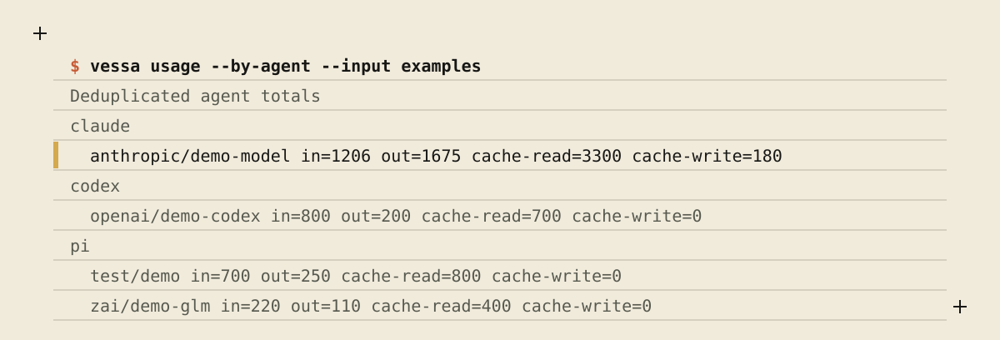
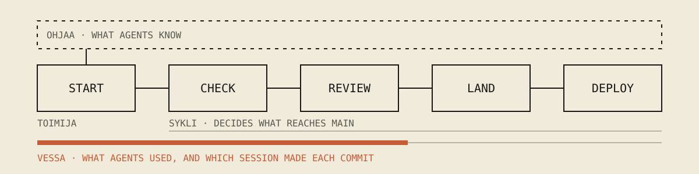

# vessa

vessa is a local command-line tool that reads the session files coding
agents leave on disk and reports the token usage they recorded.

It is for someone who works with coding agents such as Claude Code, Codex, pi
or opencode and wants to know what a session, a week or a model used. You
need git and Rust to install it from source, and the sessions of at least one
of those agents on your machine.

Claude Code, Codex, pi and opencode each write their sessions in a different
format, and none of them gives you one view across all of them. vessa reads
those files where they are and counts what they recorded, by session,
provider and model. It keeps measured numbers apart from anything inferred.
A count that is missing stays unknown; it never becomes zero. Nothing leaves
your machine, and the files it reads are never changed.

## See it



<details><summary>The same, as text</summary>

```console
$ vessa usage --by-agent --input examples
Deduplicated agent totals
claude
  anthropic/demo-model in=1206 out=1675 cache-read=3300 cache-write=180
codex
  openai/demo-codex in=800 out=200 cache-read=700 cache-write=0
pi
  test/demo in=700 out=250 cache-read=800 cache-write=0
  zai/demo-glm in=220 out=110 cache-read=400 cache-write=0
```

</details>

This runs on the sample sessions in `examples/`, so you can repeat it in a
clone. Each line is what that agent recorded for one model: input, output and
cache tokens, kept apart. When a session cannot be read in full, vessa says
the result is partial, names each limitation and exits with code 4.

## Install

vessa runs on macOS and Linux. Windows is not supported: under WSL it runs as
the Linux program, and reads the sessions of agents that run inside WSL.

Today vessa builds from source with Rust. The toolchain version is pinned in
`rust-toolchain.toml` (1.98), and `rustup` installs it on the first build.

```sh
git clone https://github.com/false-systems/vessa
cd vessa
cargo install --path .
```

vessa is not on crates.io yet. Once it is published, `cargo install vessa`
installs it with Rust 1.98 or newer; until then, use the commands above.

No release is published yet. Once one is, this line installs a prebuilt
binary to `~/.local/bin` after checking it against the release's checksums,
with `v<version>` being the release's tag:

```sh
curl -fsSL https://raw.githubusercontent.com/false-systems/vessa/main/install.sh | sh -s -- v<version>
```

Reading opencode sessions also needs the `sqlite3` command (3.33 or newer)
on your `PATH`. The other agents need nothing extra.

## Use

A 60-second start, from the clone:

```sh
vessa usage --by-agent --input examples  # the sample sessions, to see the shape
vessa sessions                           # your own sessions: what it found and could not read
vessa usage --by-agent                   # your token totals for each agent and model
vessa stats --period week                # the same, week by week
```

Without `--input`, vessa reads the agents' default folders under your home
folder. Pass `--input PATH` to read a specific file or directory.

```sh
vessa sessions                     # which sessions it found, and what it could not read
vessa usage --by-agent             # token totals for each agent and model
vessa stats --period week          # usage by day, week, month or year, in UTC
vessa status --session ID          # the latest recorded usage of one session
vessa report --output report.html  # a private, standalone HTML report
vessa secrets --since 7d           # whether a credential this machine holds reached a session
```

`vessa messages` lists the messages people typed, with secret-looking tokens
redacted. Add `--json` to most commands for machine-readable output, and
`--agent claude|codex|pi|opencode` to select one agent.

Exit code 0 means the evidence is complete, 4 means it is partial, and 1
means the command failed.

## How it fits

vessa is one of four small tools for working with coding agents. Each one works
alone.



- **toimija** starts the session and gives the agent the facts of the repository.
- **sykli** runs the declared checks, keeps the proof, and reviews, lands and deploys the work.
- **ohjaa** holds what agents are told. A person decides it.
- **vessa** counts what agents used.

[Your first loop](https://github.com/false-systems/toimija/blob/main/docs/first-loop.md) walks one change through all four tools.

## What it does not do

- It has no prices, costs, credits, budgets or limits. It counts tokens.
- It does not estimate. A number the agent did not record stays unknown.
- It sees only the session files on this machine, not other devices or a
  provider's account.
- It does not run, launch or control agents, and it does not run in the
  background.
- `vessa secrets` finds credentials this machine holds. It cannot recognize
  every possible secret, and it never prints a value.

## More

- [Reference](docs/reference.md): every command, the JSON formats, and how each agent's records are counted.
- [Agent guide](AGENTS.md): for agents that work on vessa itself.
- [Licence](LICENSE): MIT.
